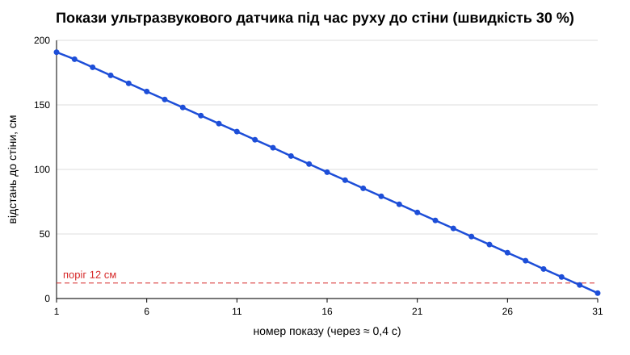

# Покази датчика — робота 4

Датчик: **ультразвуковий** (`UltrasonicSensor(INPUT_2)`), показ — `distance_centimeters`, см.
Світ Gears: Grid. Робот їде до стіни зі швидкістю 30 %, покази знято в русі кожні ≈ 0,4 с (програма записує їх у список і друкує наприкінці, бо `print` у кожній ітерації сильно сповільнює симулятор).

Нерухомий датчик у Gears щоразу дає те саме число (шуму немає), тому заміри зроблено в русі.

| № | де був робот | показ, см |
|---|---|---|
| 1 | далеко від стіни | 190,8 |
| 2 | далеко від стіни | 185,4 |
| 3 | далеко від стіни | 179,1 |
| 4 | далеко від стіни | 172,9 |
| 5 | далеко від стіни | 166,7 |
| 6 | далеко від стіни | 160,4 |
| 7 | далеко від стіни | 154,2 |
| 8 | далеко від стіни | 148 |
| 9 | далеко від стіни | 141,7 |
| 10 | далеко від стіни | 135,5 |
| 11 | далеко від стіни | 129,3 |
| 12 | далеко від стіни | 123 |
| 13 | далеко від стіни | 116,8 |
| 14 | далеко від стіни | 110,4 |
| 15 | далеко від стіни | 104,2 |
| 16 | середня відстань | 97,9 |
| 17 | середня відстань | 91,7 |
| 18 | середня відстань | 85,4 |
| 19 | середня відстань | 79,2 |
| 20 | середня відстань | 73 |
| 21 | середня відстань | 66,7 |
| 22 | середня відстань | 60,5 |
| 23 | середня відстань | 54,3 |
| 24 | середня відстань | 48 |
| 25 | середня відстань | 41,8 |
| 26 | середня відстань | 35,5 |
| 27 | близько до стіни | 29,3 |
| 28 | близько до стіни | 22,9 |
| 29 | близько до стіни | 16,7 |
| 30 | близько до стіни | 10,5 |
| 31 | близько до стіни | 4,2 |

Найменший показ: **4,2 см**, найбільший: **190,8 см**; всього 31 показ.

## Графік

Графік (файл `grafik.svg`): показ плавно спадає від 190,8 до 4,2 см приблизно по 6 см за крок. Чітких «полиць» тут немає: ультразвуковий датчик увесь час дивиться на ту саму стіну, тому замість двох рівнів виходить рівна похила лінія (для датчика кольору були б «полиці» світлого й темного). Червона пунктирна лінія — обраний поріг 12 см.
